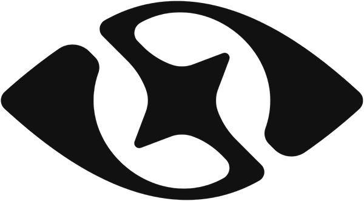

<p align="center">
  <picture>
    <source media="(prefers-color-scheme: dark)" srcset="https://raw.githubusercontent.com/opticagents/optic-agent/main/brand/logo-light.png">
    
  </picture>
</p>

<h1 align="center">optic-agent</h1>

<p align="center"><b>Balance beyond noise.</b> OPTIC in your terminal.</p>

<p align="center">
  <a href="https://www.npmjs.com/package/optic-agent"></a>
  <a href="https://github.com/opticagents/optic-agent"></a>
  <a href="https://opticagents.com"></a>
  <a href="LICENSE"></a>
</p>

OPTIC is a portfolio agent on Robinhood Chain built on the barbell strategy. Most of a portfolio sits on the **safe side** (tokenized stocks and ETFs, USDG); a small share rides the **meme side** (Pons memecoins). Every five minutes six on-chain readings become a **market score** from 1 (panic) to 10 (euphoria). In euphoria it takes meme profit into stocks, in panic it buys memes back with safe-side money, in between it only moves on a large drift.

This package only **reads**. It holds no keys and signs nothing. Rebalancing happens in the web terminal at **[opticagents.com/app](https://opticagents.com/app)**, where your own wallet confirms every step.

## Use

```sh
npx optic-agent                 # the market score, its six readings and the note
npx optic-agent record          # the four house books and what Optic AI did
npx optic-agent picks           # memes that pass the rug scan right now
npx optic-agent bar 0x…         # safe side, meme side and the rebalance plan for any wallet
npx optic-agent watch           # the score, refreshed every minute
```

Or install once and run `optic`:

```sh
npm i -g optic-agent
optic
```

`OPTIC_URL` points the CLI at another OPTIC server, for example your own: `OPTIC_URL=http://127.0.0.1:4350 optic`.

## The score

| Reading | Weight |
|---|---|
| Pons volume against its own baseline | 25% |
| Share of Pons volume that is buying | 25% |
| Pons launch rate | 10% |
| ETH 24 h move | 15% |
| SPY / QQQ token 24 h move | 10% |
| Tone of ETH and SPY headlines (VADER) | 15% |

Code computes the score, the rule and the picks. Claude only writes the short note under the number.

## The rule

- Score 8 or higher and the meme side over target: trim it back to target.
- Score 3 or lower and the meme side under target: top it up to target, spending USDG first.
- Anything in between: act only on a drift beyond the band, and never against the score.
- Memes it may buy are the busiest Pons tokens of the last 24 h, older than 6 h, still on their curve, with rug risk under 30.

## Honest limits

The score describes the last few hours; it is not a forecast. Four public paper books, opened the same day with the same money, show whether following it helps. Stock tokens follow their stocks through on-chain pools and are not shares. Not financial advice. Not affiliated with Robinhood, Uniswap or Pons.

## License

MIT
